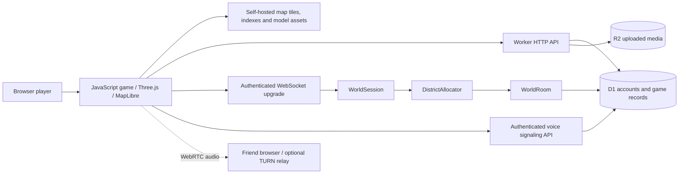

# Worldfolk architecture

Worldfolk is one repository with two client layers: a JavaScript game under `public/game/` and a React/TypeScript application/API built through Vinext and Vite. The deployment target is Cloudflare Workers. It is not a Rust/Wasm engine or an Unreal export.

## Runtime boundaries

The diagram shows responsibilities, not a guarantee of production capacity. Read [multiplayer limits](multiplayer-capacity.md) before proposing large-scale changes.

## Where to change what

| Responsibility | Main entry points |
| --- | --- |
| Boot, game state, input and UI coordination | `public/game/app.js`, `account.js`, `city-welcome.js` |
| 3D scene and camera | `world3d.js`, `chase-camera.js`, `render-utils.js` |
| Scene streaming / LOD / material lifecycle | `world-streaming.js`, `lod-catalog.js`, `graphics-materials.js`, `pbr-materials.js` |
| Map presentation / searchable destinations | `map-style.js`, `overhead-map.js`, `place-search.js`, `city-destinations.js` |
| Geography and routing | `public/maps/accra-v1/`, `osm-routing.js`, `server/maps/` |
| Landmarks / city packages | `city-landmarks.js`, named renderer/data/map/layout modules |
| Pedestrian access and shared elevation | `building-physics.js`, `precinct-navigation.js`, `precinct-life.js` |
| Vehicles, public transport and driving | `vehicle-models.js`, `traffic-routing.js`, `transit.js`, `app/api/game/ride.ts` |
| Jobs, needs, purchases and venue activities | `work-catalog.js`, `life-catalog.js`, `app/api/game/life.ts`, `interior3d.js` |
| Authentication / ownership | `app/api/auth/route.ts`, `server/passwords.ts`, `server/player-session.ts` |
| Player profile, friends, chat, ads, voice | Corresponding handlers under `app/api/`, plus `server/community-validation.ts`, `voice-ice.ts` |
| Live session / district admission / rooms | `server/realtime.ts`, `world-routing.ts`, `world-room.ts` |
| Worker entry / bindings | `build/sites-worker.ts`, `vite.config.ts`, `.openai/hosting.json` |
| Schema / migrations | `db/schema.ts`, ordered `drizzle/*.sql` |

Paths in the table are relative to the repository; client filenames are under `public/game/` unless a directory is specified.

## Authority and persistence

Player accounts and sessions identify the caller. APIs load that player from the session and validate permissions; browser-supplied player IDs, balances or destinations are not trusted authority. D1 stores accounts, saved players/life state, social records, messages, voice signaling and ad administration. R2 stores validated uploaded media. Fictional game balances and the manually approved real-money advertising workflow are separate systems.

The realtime session chooses a district room via an allocator. A room validates movement and checkpoints it to D1. Explicit travel/restart and routine saves must remain distinguishable: stale polling or checkpoints must not overwrite newer accepted positions. Preserve revision/session invariants when changing state synchronization. Shared precinct navigation lets client collision and server elevation validation use the same steps/platform rules.

Voice signaling is authenticated; WebRTC carries audio between players, with TURN when configured. This is not server-side voice recording. See [accounts](accounts.md) and [voice](voice-calls.md) for concrete limits.

## Geography, models and build-time data

OSM footprints/roads provide geographic structure, not photographed facades. Authored models own explicit native source IDs so the generic extrusion does not overlap them. Arrivals must connect to usable ground/public approaches. A reconstructed exterior does not establish that an interior is surveyed or publicly accessible.

City builders under `scripts/realism/` prepare native inventories and clipped layouts offline. LOD builders produce catalogs/meshes under `public/game/assets/lods/`; tests pin hashes and geometry budgets. Generated files belong in PRs with their sources. Raw downloads, database state and review captures belong outside the runtime asset tree. See the [place workflow](contributing/places.md).

## Rendering and performance

The browser shares finite GPU/CPU resources across map and 3D rendering. Keep per-frame work bounded, reuse materials/geometries, filter local collision candidates, avoid new GPU contexts/lights/passes without evidence, and dispose resident resources when streaming out. Preserve landmark silhouettes in distant models. Runtime clipping, unbounded crowd generation and full-city polling are inappropriate defaults.

Geometry/asset tests catch some regressions. They do not establish frame-time stability on a physical phone. Shader startup, scene entry/streaming and control responsiveness need measured browser/device checks. See the [rendering notes](realism/browser-graphics-architecture.md) and [benchmark protocol](realism/mobile-performance-benchmark.md).

## Deployment identity

The build emits `dist/server/wrangler.json`. The standalone preparation script creates a domain-specific Cloudflare config. Source `.openai/hosting.json` retains the Sites project identity; local bindings are emulated by the Vite Cloudflare plugin. Internal starter/package names and Durable Object migration tags are persistent identities, not cosmetic text to rename casually.

## Current architectural debt

Large orchestration modules, compact legacy formatting, mixed API fixture conventions, reference gaps, mobile frame spikes and unverified scale remain active work. The [roadmap](roadmap.md) tracks incremental improvements; avoid a wholesale engine rewrite without profiling and a migration plan.
